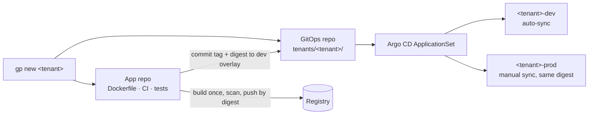

# Golden Path

A paved road for shipping a stateless HTTP service onto a GitOps-run Kubernetes cluster. One command scaffolds the app, its CI, its deployment, its guardrails and its observability; one more checks the result offline before anything reaches the cluster.

  

Built for my homelab platform: an HA k3s cluster where Argo CD reconciles every application from Git. Write-ups and architecture are at [leemark.dev](https://leemark.dev).

## Why

The lab already had one service shipping well: build once, scan, push by digest, promote through Git. Every new service copied that by hand and drifted. Golden Path pulls the working pattern out into templates and a small CLI, so the second service starts where the first one ended up. It does not add a portal or a new cluster ([ADR-0001](docs/adr/0001-scope-and-non-goals.md)).

## What `gp new` generates



| Layer | What you get |
|---|---|
| **App** | A static (nginx, non-root) or Node starter with digest-pinned base images and a strict `.dockerignore` |
| **CI** | Tests, then one build that is scanned (HIGH/CRITICAL block), recorded as an SBOM and pushed by digest, then a commit of that exact digest to the dev overlay |
| **Deploy** | Kustomize base plus dev and prod overlays, picked up by one Argo CD ApplicationSet under a tenants AppProject |
| **Guard** | Default-deny NetworkPolicies, namespace quotas and limit ranges, Pod Security labels, and a sealed-secret placeholder (the CLI never emits a credential) |
| **Observe** | Multi-window burn-rate SLO alerts (99.5% availability; latency staged until real traffic is measured), a Grafana dashboard and Promtool unit tests for the rules |

The repository also ships twelve operational runbooks (the SLO and telemetry alerts link to theirs through `runbook_url`) and a template for read-only SRE incident scenarios.

Prod never gets a rebuild. It gets the same digest that passed in dev ([ADR-0006](docs/adr/0006-build-once-promote-digest.md)).

## Quickstart

Node 26 or later. No `npm install`: the CLI has no dependencies.

```sh
bin/gp list-kinds
bin/gp new demo --kind static \
  --app-repo "$PWD/.gp-tmp/demo-app" \
  --gitops "$PWD/.gp-tmp/demo-gitops" --dry-run   # review the file list first
bin/gp new demo --kind static \
  --app-repo "$PWD/.gp-tmp/demo-app" \
  --gitops "$PWD/.gp-tmp/demo-gitops"
bin/gp verify .gp-tmp/demo-app
```

`gp` never overwrites a file and has no force flag. To upgrade a service, scaffold into scratch and review the diff.

## Verification

`gp verify` runs every gate it can, offline, and reports each one as PASS, FAIL or SKIP:

- the generated app's own tests and `shellcheck`;
- `kustomize build` of both overlays, rejecting remote bases, Helm inflation and secret generators;
- Kyverno against the cluster's real policy file, counting Audit warnings as failures ([ADR-0013](docs/adr/0013-policy-conformance.md));
- Trivy config scanning and kubeconform against local schemas;
- `promtool check` and `promtool test` on the generated alert rules;
- a network-less `docker build` once base images are pinned and cached.

A missing tool or input is a SKIP with a reason, and the summary says INCOMPLETE. An exit code of 0 never stands in for a gate that did not run.

```sh
npm test       # 55 Node tests
make verify    # tests, shellcheck, link check and a scaffold of both kinds
```

The Kyverno cases look for the cluster policy in a sibling `../gitops` checkout, or wherever `GP_GITOPS_REFERENCE` points. Without one they skip rather than test against a bundled copy.

## Adapting it

Hostnames are placeholders: `registry.example.com`, `git.example.com/platform/gitops` and `*.apps.example.com`. The cluster path is `clusters/homelab`. Change them in `src/scaffold.mjs`, the CI templates under `templates/ci/` and the Argo CD manifests in `platform/`. [docs/template-contract.md](docs/template-contract.md) lists the template placeholders `gp` fills in.

## Layout

| Path | Contents |
|---|---|
| `bin/`, `src/` | The `gp` CLI: scaffold, render and verify |
| `templates/` | App, CI, deploy, guard, namespace and observability templates |
| `platform/` | One-time Argo CD AppProject and ApplicationSet, plus the integration patch for the GitOps repo |
| `test/` | Node tests for every stage |
| `docs/adr/` | Seven of the fifteen design decisions |
| `docs/runbooks/` | Operational runbooks, read-only diagnosis first |
| `docs/usage.md` | Onboarding and lifecycle |

## Status

The CLI, templates and tests are complete. All 55 tests pass, and `make verify` passes with the gates whose tools are installed; promtool, kind, conftest, the Docker build and kubeconform schemas report SKIP without their inputs. The first tenant, the internal build of my portfolio site, went live in its dev environment on the lab cluster on 30 October 2026 through this path and passed a critical-page alert drill. Prod waits on dev acceptance, a warning-board drill and approval.

This repository is a curated public copy of a private one. The lab's private wiring (real hostnames, the live tenant and its credentials, and internal planning documents) stays in the private repository.

## License

[MIT](LICENSE)
